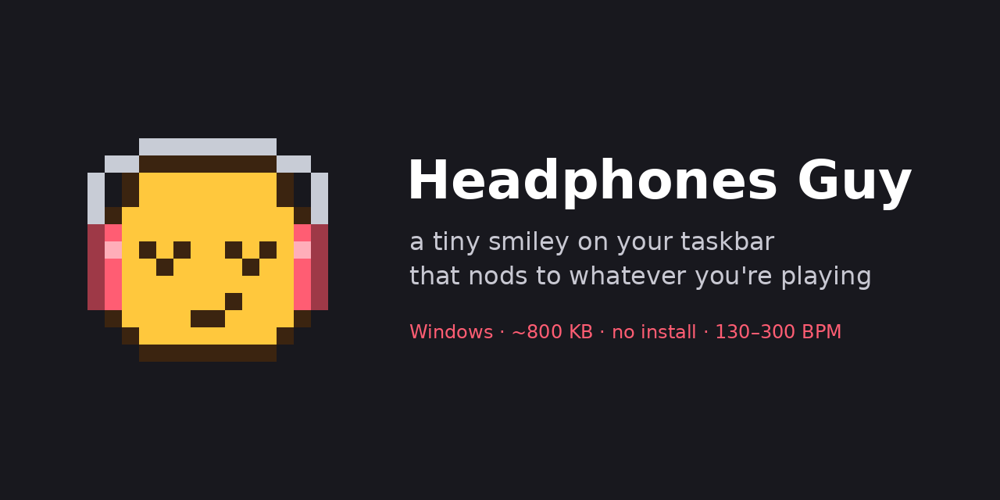
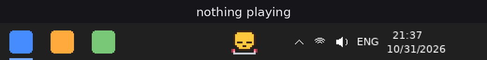
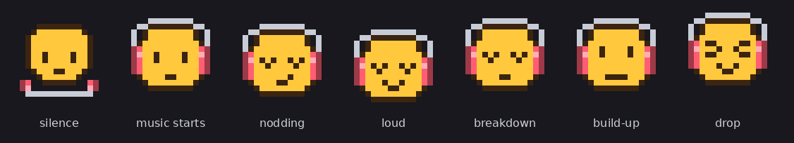

<p align="center">
  
</p>

<p align="center">
  <b>A tiny pixel smiley that lives on your Windows taskbar and nods to whatever you're playing.</b><br>
  Spotify, YouTube, a DJ set, a game — if Windows plays it, he hears it.
</p>

<p align="center">
  <a href="../../releases/latest"></a>
  
  
  
</p>

<p align="center">
  
</p>

## What it does

He sits next to your tray icons and listens to the sound your PC is putting out, then **nods exactly on the beat**. No setup, no audio routing, no virtual cables.

- **Beat tracking in real time**: tempo and beat position from the system audio, re-locks within seconds when the track changes or you scrub.
- **Built for fast music**: tuned on hardcore, uptempo, terror, breakcore, DnB, neurofunk and dubstep. Handles **130–300 BPM**, including the nasty 130-vs-260 and 3:4 polyrhythm cases.
- **Knows the song structure**: nods deeper on loud parts, chills on breakdowns, shivers during build-up snare rolls, and **loses it on the drop**, for the whole drop rather than just a second.
- **Has a life**: headphones around his neck when nothing plays, blinks, wakes up when music starts.
- **Featherweight**: one ~800 KB `.exe`, no installer, no dependencies, ~2% of one CPU core.
- **Private**: no network access at all. Audio is analysed in memory and thrown away.

<p align="center">
  
  &nbsp;&nbsp;
  
</p>

## Download & run

1. Grab **`HeadphonesGuy.exe`** from the [latest release](../../releases/latest).
2. Run it. He appears on the taskbar, left of the tray icons.
3. Play some music.

> **"Windows protected your PC"?** The exe isn't code-signed (certificates cost money), so SmartScreen warns on first launch. Click **More info → Run anyway**. The full source is right here, and you can build it yourself in a minute (see below).

To quit, change settings or make him start with Windows, **click his icon in the tray**.

## Tray menu

| Item | What it does |
|---|---|
| Move left / Move right / Reset position | Nudge him along the taskbar if he overlaps something |
| Nod earlier / later (±10 ms, ±50 ms) | Sync the nod to your ears. **Bluetooth headphones** are usually 150–250 ms late, so use *Much later* a few times |
| Headphone color | 8 presets or any custom color |
| Go harder on loud parts and drops | Turn the dynamic moves (deep nods, drop face, build-up shiver) on or off |
| Start with Windows | Adds or removes him from autostart (current user, no admin) |

He hides automatically when a fullscreen game or video is on that monitor, and comes back afterwards.

## Settings file

Everything from the menu is saved to `%APPDATA%\HeadphonesGuy\settings.ini`. A few extra knobs only live there:

```ini
[guy]
offset=0            ; horizontal shift in pixels
nod_offset_ms=10    ; nod timing, -500..500
cups_color=FF5D73   ; headphone color, RRGGBB
moves=1             ; deep nods / drop / build-up animations
language=auto       ; auto | en | ru
sharp_onsets=1      ; 0 = older, softer onset timing (try it if the nod feels late on your music)
log=0               ; 1 = write mode/BPM to log.txt once per second
```

## How it works

```
system audio (WASAPI loopback)
   └─ spectral flux, 2048-pt FFT every 5 ms ──► tempo: autocorrelation + long tempo memory (prior ~170 BPM)
   └─ kick-weighted flux, 11 ms window ──────► beat phase: long + short beat histograms, seek / track-change recovery
   └─ bass share of the mix ─────────────────► sections: loud / breakdown / build-up (snare roll density) / drop
                                                    │
                              render thread ◄───────┘  nod frames scheduled on the predicted beat grid
```

A few things that make it behave on extreme music:

- **Track changes**: a fresh 6 s window keeps voting against the long tempo memory, and when the old tempo loses its support the memory restarts. Back-to-back tracks re-lock in about 4–7 s, crossfades included.
- **130 or 260?** At 240+ BPM hi-hats lie, so the double tempo is only accepted when the snare/body band agrees over several seconds.
- **3:4 polyrhythms**: triplet rolls and dotted kick patterns can't drag the tempo away unless kick *and* snares really move.
- **Drops** are detected from how much of the mix the bass takes, so the overall loudness of the master doesn't matter. A real break or build has to come first, and the drop face stays on until the bass gives way again.
- **Seeking**: a short hole in the audio (or a discontinuity flag from Windows) triggers a fresh phase lock from the next second of audio. Gapless jumps are caught by a short beat histogram within a few seconds.

All the DSP is in one portable header, [`src/tracker.h`](src/tracker.h), with no Windows code in it. The Win32 side (taskbar placement, layered window, tray, WASAPI) is [`src/main.cpp`](src/main.cpp).

## Build it yourself

You need MinGW-w64. From Linux or WSL:

```sh
sudo apt install g++-mingw-w64-x86-64-win32 binutils-mingw-w64-x86-64
sh build.sh            # -> build/HeadphonesGuy.exe
```

On Windows with [MSYS2](https://www.msys2.org/):

```sh
pacman -S mingw-w64-x86_64-gcc
CXX=g++ WINDRES=windres sh build.sh
```

## Tests

The tracker builds with any C++17 compiler, no Windows needed:

```sh
cd tests
g++ -O2 -std=c++17 -I../src test_tracker.cpp     -o t && ./t   # synthetic genres 132–260 BPM
g++ -O2 -std=c++17 -I../src test_transitions.cpp -o t && ./t   # back to back, crossfades, same-BPM shifts, breakdowns
g++ -O2 -std=c++17 -I../src test_chaos.cpp       -o t && ./t   # breakcore triplet rolls must not fool it
```

`test_seek.cpp` and `eval.cpp` run on your own tracks (decoded with ffmpeg to raw float32, 48 kHz mono). See the comment at the top of each file.

## FAQ

**My antivirus flags it.** Small unsigned exes that capture audio and sit on top of the taskbar sometimes trip heuristics. It makes no network calls and writes only to its own settings folder. Build it from source if you want to be sure.

**He nods a bit late or early.** Use *Nod earlier / later* in the tray menu. Bluetooth adds 150–250 ms. For wired headphones the default is usually right.

**He picked half or double the tempo.** That happens on tracks where both feel valid (dubstep at 150/300, halftime breaks). He usually corrects himself within a few seconds once the drums make it clear.

**Multiple monitors / vertical taskbar?** He lives on the primary taskbar and supports horizontal and vertical layouts, plus per-monitor DPI.

**Windows 11?** Developed and used on Windows 10. Windows 11 uses the same taskbar window classes, so it should work. If he shows up in a weird place, open an issue with a screenshot.

**Does it work with any player?** Yes. He listens to the Windows output device, not to a specific app. If you switch the default output device he follows it.

## License

[MIT](LICENSE). Do whatever you want, a link back is appreciated.
